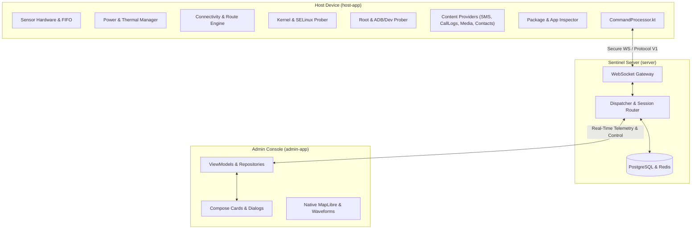
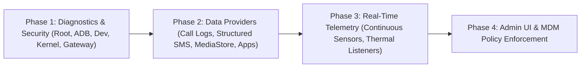

# Project Sentinel — Advanced Features Implementation Blueprint & Architecture Roadmap

**Document Version:** 1.0.0  
**Target Systems:** `host-app` (Android 10–16 / API 29–36), `server` (Go 1.22+ / Gorilla WebSocket / PostgreSQL / Redis), `admin-app` (Jetpack Compose / Kotlin Coroutines / MapLibre)  
**Security Model:** Enterprise Mobile Device Management (MDM), Zero-Trust Telemetry, Defense-in-Depth  
**Repository Working Directory:** `/Users/ayush/Desktop/Servillance`

---

## Executive Summary & System Baseline

Project Sentinel is an enterprise-grade mobile device supervision, diagnostics, and telemetry platform. Following the successful stabilization of the **Pass 5 Admin Presentation Review** (305 passing unit tests, zero lint warnings, native MapLibre integration, and verified hardware callsign resolution on physical test devices like the Vivo iQOO 12/13), this document establishes the definitive implementation guide for the next major engineering milestone.

This roadmap details the exact status of 12 core diagnostic and monitoring features, identifies missing capabilities, and provides an end-to-end implementation plan across Android clients, the Go backend dispatcher, and the Jetpack Compose admin console.



---

## High-Level Feature Status Matrix

| # | Feature Area | Current Status in Repository | Missing / Required Actions | Impact / Priority |
|---|---|---|---|---|
| 1 | **Sensors** | Partial. Accelerometer active for impact/fall in [`FallDetector.kt`](file:///Users/ayush/Desktop/Servillance/host-app/data/src/main/java/com/sentinel/host/data/device/FallDetector.kt). | Gyroscope, Magnetometer, Barometer, Light, and Proximity streaming; waveform visualization in admin. | **HIGH** |
| 2 | **Battery & Thermals** | Snapshot only via `ACTION_BATTERY_CHANGED` in [`SystemInfoProvider.kt`](file:///Users/ayush/Desktop/Servillance/host-app/data/src/main/java/com/sentinel/host/data/device/SystemInfoProvider.kt). | Real-time `OnThermalStatusChangedListener`, discharge rate (%/hr), wattage calculation, critical alerts. | **HIGH** |
| 3 | **Wi-Fi Gateway IP** | Local IP, SSID, band, and link speed extracted. | Default Gateway IP, DNS 1 & 2, subnet mask, IPv6 routes, and Public WAN IP resolution. | **MEDIUM** |
| 4 | **Kernel Info** | Basic string split on `/proc/version`. | Full POSIX `uname` (`sysname`, `release`, `machine`), SELinux status, bootloader version. | **MEDIUM** |
| 5 | **Root Detection** | Basic shell exit code checks only. | 6-layer root & tampering detection (su binaries, test-keys, Magisk/KSU packages, mount rw checks). | **CRITICAL** |
| 6 | **ADB Status** | Not implemented. | `Settings.Global.ADB_ENABLED` detection, ContentObserver for real-time toggle alerts, MDM disable policy. | **HIGH** |
| 7 | **USB Debugging** | Not implemented. | Sticky `USB_STATE` broadcast parsing (ADB vs MTP link), Wireless Debugging (API 30+) detection. | **MEDIUM** |
| 8 | **Developer Options** | Not implemented. | `Settings.Global.DEVELOPMENT_SETTINGS_ENABLED` detection, mock location prober, MDM restriction. | **MEDIUM** |
| 9 | **Contacts** | Implemented via [`ContactsManager.kt`](file:///Users/ayush/Desktop/Servillance/host-app/data/src/main/java/com/sentinel/host/data/device/ContactsManager.kt) for phone numbers. | Pagination / cursor support, email, address, company, and thumbnail base64 sync. | **MEDIUM** |
| 10 | **Call Logs** | Not implemented. | `READ_CALL_LOG` permission, query `CallLog.Calls`, pagination, incoming/outgoing/missed categorization. | **HIGH** |
| 11 | **Messages & Images** | Text SMS inbox in [`SmsManager.kt`](file:///Users/ayush/Desktop/Servillance/host-app/data/src/main/java/com/sentinel/host/data/device/SmsManager.kt); single file preview. | MMS support, SMS threads, `MediaStore` gallery synchronization with thumbnail caching. | **HIGH** |
| 12 | **Specs & App List** | Full hardware specs in [`HardwareInfoProvider.kt`](file:///Users/ayush/Desktop/Servillance/host-app/data/src/main/java/com/sentinel/host/data/device/HardwareInfoProvider.kt). Apps missing. | `QUERY_ALL_PACKAGES`, app label, package name, version, system vs user filter, remote freeze/uninstall. | **HIGH** |

---

## Detailed Feature Specifications & Implementation Blueprints

---

### 1. Sensors (Hardware Integration & Real-Time Telemetry)

#### Current Implementation
- **Location:** [`host-app/data/src/main/java/com/sentinel/host/data/device/FallDetector.kt`](file:///Users/ayush/Desktop/Servillance/host-app/data/src/main/java/com/sentinel/host/data/device/FallDetector.kt)
- **Status:** Uses `Sensor.TYPE_ACCELEROMETER` exclusively for fall and severe impact detection (`FREE_FALL_THRESHOLD = 2.0f`, `IMPACT_THRESHOLD = 45.0f`).
- **Admin UI:** [`SensorHistoryDialog.kt`](file:///Users/ayush/Desktop/Servillance/admin-app/app/src/main/java/com/sentinel/admin/ui/detail/SensorHistoryDialog.kt) displays static placeholder waveforms because no live stream is delivered from the host.

#### What Needs to Be Added & Corrected
1. **Multi-Sensor Support:** Continuous or on-demand streaming of:
   - Gyroscope (`Sensor.TYPE_GYROSCOPE`): Angular velocity (X, Y, Z in rad/s).
   - Magnetometer (`Sensor.TYPE_MAGNETIC_FIELD`): Ambient geomagnetic field (μT) for orientation and compass heading.
   - Barometer (`Sensor.TYPE_PRESSURE`): Atmospheric pressure (hPa) for elevation tracking.
   - Ambient Light (`Sensor.TYPE_LIGHT`): Illuminance (lux) to determine environment (pocket, indoors, daylight).
   - Proximity (`Sensor.TYPE_PROXIMITY`): Detection of proximity to face or enclosure.
2. **Battery & Power Efficiency:** Avoid registering listeners at `SENSOR_DELAY_FASTEST` without bounds. Utilize hardware FIFO batching (`registerListener(listener, sensor, delay, maxReportLatencyUs)`).
3. **Android 12+ Rate Limits:** Comply with the 200 Hz sampling rate cap on Android 12+ without declaring unnecessary background permissions unless explicitly required.

#### Implementation Steps
- **`host-app`:**
  1. Create `SensorTelemetryManager.kt` implementing `SensorEventListener`.
  2. Implement on-demand subscription commands (`START_SENSOR_STREAM`, `STOP_SENSOR_STREAM`) with configurable sampling rates (`UI`, `NORMAL`, `GAME`).
  3. Batch samples into JSON payloads emitted every 250ms–500ms to preserve radio sleep cycles.
  4. Register handlers in [`CommandProcessor.kt`](file:///Users/ayush/Desktop/Servillance/host-app/service/src/main/java/com/sentinel/host/service/CommandProcessor.kt).
- **`server`:**
  1. Define `SensorStreamMessage` in `server/internal/protocol/types.go`.
  2. Route sensor frames to listening admin sessions in `server/internal/dispatcher/dispatcher.go`.
- **`admin-app`:**
  1. Update `DeviceDetailViewModel.kt` to bind to `SensorTelemetryUpdate` events.
  2. Wire Canvas line charts in [`SensorHistoryDialog.kt`](file:///Users/ayush/Desktop/Servillance/admin-app/app/src/main/java/com/sentinel/admin/ui/detail/SensorHistoryDialog.kt) to render real-time rolling waveforms.

---

### 2. Battery Usage and Thermals

#### Current Implementation
- **Location:** [`host-app/data/src/main/java/com/sentinel/host/data/device/SystemInfoProvider.kt`](file:///Users/ayush/Desktop/Servillance/host-app/data/src/main/java/com/sentinel/host/data/device/SystemInfoProvider.kt#L33-L48)
- **Status:** Captures a point-in-time snapshot during `GET_SYSTEM_INFO`:
  - Battery level %, scale, temperature (°C), plugged state (AC/USB/Wireless), voltage (mV), health string, and tech string.
  - Snapshot thermal status via `PowerManager.currentThermalStatus` (API 29+).
- **Admin UI:** [`BatteryAccordionCard.kt`](file:///Users/ayush/Desktop/Servillance/admin-app/app/src/main/java/com/sentinel/admin/ui/detail/BatteryAccordionCard.kt) presents current status and static gauges.

#### What Needs to Be Added & Corrected
1. **Dynamic Thermal Event Dispatch:** A one-time query misses critical thermal events. The app must register `PowerManager.OnThermalStatusChangedListener` to alert the admin immediately when the device throttles (`THERMAL_STATUS_SEVERE` or `CRITICAL`).
2. **Discharge Rate Calculus:** Calculate battery drain rate (% per hour) based on a rolling 1-hour window.
3. **Instantaneous Current & Power:** Read `BatteryManager.BATTERY_PROPERTY_CURRENT_NOW` (microamperes) to compute real-time power draw in Watts ($P = V \times I$).
4. **Critical Threshold Alerts:** Proactively push push notifications or WebSocket alerts when battery drops below 15% or temperature exceeds 45°C.

#### Implementation Steps
- **`host-app`:**
  1. Create `BatteryThermalMonitor.kt` with a dynamic `BroadcastReceiver` for `Intent.ACTION_BATTERY_CHANGED`.
  2. Register `PowerManager.addThermalStatusListener(executor, listener)` on API 29+.
  3. Query `BatteryManager.getIntProperty(BatteryManager.BATTERY_PROPERTY_CURRENT_NOW)`.
  4. Emit `BATTERY_TELEMETRY_UPDATE` and `THERMAL_ALERT` when thresholds are breached.
- **`server`:**
  1. Store historical battery telemetry points in PostgreSQL (`device_battery_history`) for trend graphing.
- **`admin-app`:**
  1. Add live charging wattage and drain rate indicators to [`BatteryAccordionCard.kt`](file:///Users/ayush/Desktop/Servillance/admin-app/app/src/main/java/com/sentinel/admin/ui/detail/BatteryAccordionCard.kt).
  2. Implement visual badges for thermal throttling states.

---

### 3. Wi-Fi Internet Gateway IP & Network Link Routing

#### Current Implementation
- **Location:** [`host-app/data/src/main/java/com/sentinel/host/data/device/SystemInfoProvider.kt`](file:///Users/ayush/Desktop/Servillance/host-app/data/src/main/java/com/sentinel/host/data/device/SystemInfoProvider.kt#L49-L84)
- **Status:** Reads SSID, frequency (2.4/5/6 GHz), link speed (Mbps), and converts integer IPv4 address to standard dotted notation.

#### What Needs to Be Added & Corrected
1. **Deprecated Wi-Fi APIs:** `WifiInfo.ipAddress` is deprecated in Android 12+ and returns `0.0.0.0` if location permissions are withheld.
2. **Missing Gateway & Routing Information:** The admin cannot see:
   - Default Router / Gateway IP.
   - Primary and Secondary DNS server addresses.
   - Subnet mask / prefix length.
   - Network Interface Name (`wlan0`, `rmnet_data0`, `tun0` for VPNs).
   - Public WAN IP (the IP the outside world sees).

#### Implementation Steps
- **`host-app`:**
  1. Transition from `WifiInfo` to `ConnectivityManager.getLinkProperties(connectivityManager.activeNetwork)`:
     ```kotlin
     val linkProperties = connectivityManager.getLinkProperties(connectivityManager.activeNetwork)
     val defaultGateway = linkProperties?.routes?.firstOrNull { it.isDefaultRoute }?.gateway?.hostAddress ?: "N/A"
     val dnsServers = linkProperties?.dnsServers?.map { it.hostAddress } ?: emptyList()
     val interfaceName = linkProperties?.interfaceName ?: "Unknown"
     ```
  2. Resolve Public WAN IP using an existing lightweight STUN binding request via the WebRTC stack or a secure enterprise HTTP endpoint.
- **`server`:**
  1. Capture client external IP directly from incoming WebSocket handshake headers (`X-Forwarded-For` or `r.RemoteAddr`).
  2. Merge internal gateway IP and external IP into `NetworkInfo` payload.
- **`admin-app`:**
  1. Update [`NetworkMotionCard.kt`](file:///Users/ayush/Desktop/Servillance/admin-app/app/src/main/java/com/sentinel/admin/ui/detail/NetworkMotionCard.kt) and [`SystemDiagnosticsDialog.kt`](file:///Users/ayush/Desktop/Servillance/admin-app/app/src/main/java/com/sentinel/admin/ui/detail/SystemDiagnosticsDialog.kt) to display Gateway IP, DNS 1 & 2, Interface, and Public WAN IP.

---

### 4. Kernel & Low-Level OS Architecture

#### Current Implementation
- **Location:** [`host-app/data/src/main/java/com/sentinel/host/data/device/SystemInfoProvider.kt`](file:///Users/ayush/Desktop/Servillance/host-app/data/src/main/java/com/sentinel/host/data/device/SystemInfoProvider.kt#L108-L113)
- **Status:** Attempts to read `/proc/version` and splits on whitespace, falling back to `System.getProperty("os.version")`.

#### What Needs to Be Added & Corrected
1. **SELinux Restrictions:** On Android 13+, reading `/proc/version` directly can be blocked by SELinux untrusted app domains, resulting in a silent failure fallback.
2. **Missing Kernel Architecture:** The system lacks structured inspection of:
   - POSIX UTS release and build toolchain (e.g., Clang version, LTO, KASLR).
   - Machine architecture (`aarch64` vs `armv7l`).
   - SELinux enforcement mode (Enforcing vs Permissive).
   - Bootloader version and baseband radio firmware version.

#### Implementation Steps
- **`host-app`:**
  1. Replace string parsing with POSIX `android.system.Os.uname()`:
     ```kotlin
     val uts = android.system.Os.uname()
     val sysname = uts.sysname      // "Linux"
     val release = uts.release      // e.g. "6.1.75-android15"
     val version = uts.version      // Full build timestamp & compiler string
     val machine = uts.machine      // "aarch64"
     ```
  2. Check SELinux status via reflection or shell probe:
     ```kotlin
     val isSelinuxEnforced = try {
         val clazz = Class.forName("android.os.SELinux")
         clazz.getMethod("isSELinuxEnforced").invoke(null) as Boolean
     } catch (_: Exception) { true }
     ```
  3. Include `Build.BOOTLOADER` and `Build.getRadioVersion()`.
- **`admin-app`:**
  1. Add an "OS & Kernel Architecture" block in [`SystemDiagnosticsDialog.kt`](file:///Users/ayush/Desktop/Servillance/admin-app/app/src/main/java/com/sentinel/admin/ui/detail/SystemDiagnosticsDialog.kt).

---

### 5. Enterprise Root & Tamper Detection

#### Current Implementation
- **Location:** [`host-app/data/src/main/java/com/sentinel/host/data/device/ShellExecutor.kt`](file:///Users/ayush/Desktop/Servillance/host-app/data/src/main/java/com/sentinel/host/data/device/ShellExecutor.kt)
- **Status:** Executes basic commands; checks exit codes. No dedicated root detection or tamper verification exists.

#### What Needs to Be Added & Corrected
1. **Vulnerability to Root Cloaking:** Basic `su` execution checks are easily spoofed by Magisk DenyList, Shamiko, KernelSU, and APatch.
2. **Missing Defense-in-Depth:** A robust enterprise MDM requires multi-layered root auditing to guarantee device integrity.

#### Implementation Steps
- **`host-app`:**
  Create `RootDetectionManager.kt` implementing a 6-vector security audit:
  1. **Binary Path Probes:** Test presence and execute permissions for `su` across:
     - `/system/bin/su`, `/system/xbin/su`, `/sbin/su`, `/system/sd/xbin/su`, `/system/bin/failsafe/su`, `/data/local/xbin/su`, `/data/local/bin/su`, `/data/local/su`.
  2. **Build Tags Audit:** Check if `Build.TAGS` contains `"test-keys"` (indicates custom or non-release ROM).
  3. **Superuser Package Enumeration:** Scan package manager for signatures of:
     - `com.topjohnwu.magisk`, `me.weishu.kernelsu`, `io.github.vvb2060.magisk`, `eu.chainfire.supersu`, `com.koushikdutta.superuser`, `com.noshufou.android.su`.
  4. **Dangerous System Properties:** Audit system properties:
     - `ro.debuggable == 1`, `ro.secure == 0`.
  5. **Mount Point Probing:** Check `/proc/mounts` for read-write mounts on `/system` or overlayfs mounts typical of systemless root frameworks.
  6. **Native C / JNI Verification:** Execute binary checks in native code to bypass Java-level Frida and Xposed hooks.
- **`server`:**
  1. Add `isRooted: Boolean` and `rootReasons: []string` to device heartbeat and registration payloads.
  2. Automatically flag device status as **COMPROMISED** in database.
- **`admin-app`:**
  1. Render a prominent Root & Compliance indicator on [`DeviceDetailScreen.kt`](file:///Users/ayush/Desktop/Servillance/admin-app/app/src/main/java/com/sentinel/admin/ui/detail/DeviceDetailScreen.kt) and [`MdmPolicyCard.kt`](file:///Users/ayush/Desktop/Servillance/admin-app/app/src/main/java/com/sentinel/admin/ui/detail/MdmPolicyCard.kt).

---

### 6. ADB (Android Debug Bridge) Status Detection

#### Current Implementation
- **Status:** Not implemented anywhere in the repository.

#### What Needs to Be Added & Corrected
- Unmonitored ADB allows external physical exploitation, unauthorized shell execution, and keyguard manipulation. In enterprise fleets, ADB status must be monitored in real time and restricted where appropriate.

#### Implementation Steps
- **`host-app`:**
  1. Query `Settings.Global`:
     ```kotlin
     val isAdbEnabled = Settings.Global.getInt(
         context.contentResolver,
         Settings.Global.ADB_ENABLED,
         0
     ) == 1
     ```
  2. Register a `ContentObserver` on `Settings.Global.getUriFor(Settings.Global.ADB_ENABLED)` to instantly emit an alert when ADB is toggled.
  3. If Device Owner is enabled, support remote enforcement:
     ```kotlin
     devicePolicyManager.addUserRestriction(adminComponent, UserManager.DISALLOW_DEBUGGING_FEATURES)
     ```
- **`server` & `admin-app`:**
  1. Include `adbEnabled` in device security cards. Provide a one-click remote toggle (for Device Owner managed endpoints).

---

### 7. USB Debugging & Link State Detection

#### Current Implementation
- **Status:** Not implemented.

#### What Needs to Be Added & Corrected
- Differentiate between:
  1. General ADB enabled in settings.
  2. Physical USB data link currently connected to a host computer.
  3. Wireless ADB (Android 11+ / API 30+) port active on the local network.

#### Implementation Steps
- **`host-app`:**
  1. Register a sticky receiver for `android.hardware.usb.action.USB_STATE`:
     ```kotlin
     val usbFilter = IntentFilter("android.hardware.usb.action.USB_STATE")
     val usbIntent = context.registerReceiver(null, usbFilter)
     val isUsbConnected = usbIntent?.getBooleanExtra("connected", false) ?: false
     val isUsbConfigured = usbIntent?.getBooleanExtra("configured", false) ?: false
     val isAdbFunctionActive = usbIntent?.getBooleanExtra("adb", false) ?: false
     ```
  2. On Android 11+ (API 30+), check Wireless Debugging:
     ```kotlin
     val isWirelessAdbEnabled = Settings.Global.getInt(
         context.contentResolver,
         "adb_wifi_enabled",
         0
     ) == 1
     ```
- **`admin-app`:**
  1. Display explicit indicators: "USB Connected (Data Active)", "USB Charging Only", or "Wireless Debugging Open".

---

### 8. Developer Options Detection & Compliance

#### Current Implementation
- **Status:** Not implemented.

#### What Needs to Be Added & Corrected
- Developer Options allow dangerous configurations including "Stay awake while charging", mock location providers (GPS spoofing), and OEM unlocking.

#### Implementation Steps
- **`host-app`:**
  1. Query `Settings.Global.DEVELOPMENT_SETTINGS_ENABLED`:
     ```kotlin
     val isDevOptionsEnabled = Settings.Global.getInt(
         context.contentResolver,
         Settings.Global.DEVELOPMENT_SETTINGS_ENABLED,
         0
     ) == 1
     ```
  2. Detect Mock Locations:
     ```kotlin
     // For Android 12+ (API 31+) on location objects:
     location.isMock
     // For system settings:
     val isMockEnabled = Settings.Secure.getInt(
         context.contentResolver,
         Settings.Secure.ALLOW_MOCK_LOCATION,
         0
     ) != 0
     ```
- **`admin-app`:**
  1. Display Developer Options and Mock Location warnings within [`MdmPolicyCard.kt`](file:///Users/ayush/Desktop/Servillance/admin-app/app/src/main/java/com/sentinel/admin/ui/detail/MdmPolicyCard.kt).

---

### 9. Contacts Auditing & Contact Synchronization

#### Current Implementation
- **Location:** [`host-app/data/src/main/java/com/sentinel/host/data/device/ContactsManager.kt`](file:///Users/ayush/Desktop/Servillance/host-app/data/src/main/java/com/sentinel/host/data/device/ContactsManager.kt)
- **Status:** Queries `ContactsContract.CommonDataKinds.Phone.CONTENT_URI` for contact name, phone number, type, and ICE emergency contact tags.
- **Admin UI:** [`ContactDetailsCard.kt`](file:///Users/ayush/Desktop/Servillance/admin-app/app/src/main/java/com/sentinel/admin/ui/detail/ContactDetailsCard.kt) and [`AddressBookDialog.kt`](file:///Users/ayush/Desktop/Servillance/admin-app/app/src/main/java/com/sentinel/admin/ui/detail/AddressBookDialog.kt).

#### What Needs to Be Added & Corrected
1. **Missing Pagination:** Fetching all contacts in a single JSON payload risks exceeding WebSocket frame limits or causing `OutOfMemoryError` on devices with thousands of contacts.
2. **Missing Extended Contact Data:** Does not query email addresses (`Email.CONTENT_URI`), physical addresses (`StructuredPostal.CONTENT_URI`), or organization/job title (`Organization.CONTENT_URI`).
3. **No Photo Thumbnails:** Lacks support for retrieving contact avatar thumbnails.

#### Implementation Steps
- **`host-app`:**
  1. Add pagination parameters (`limit`, `offset`, or cursor based on `_ID > lastSeenId`) to `ContactsManager.getContacts()`.
  2. Join queries or fetch secondary details for Email and Organization:
     ```kotlin
     val emails = context.contentResolver.query(
         ContactsContract.CommonDataKinds.Email.CONTENT_URI,
         arrayOf(ContactsContract.CommonDataKinds.Email.DATA),
         "${ContactsContract.CommonDataKinds.Email.CONTACT_ID} = ?",
         arrayOf(contactId),
         null
     )
     ```
  3. Provide an on-demand endpoint for fetching thumbnail bytes via `ContactsContract.Contacts.Photo.PHOTO_THUMBNAIL_URI`.
- **`server`:**
  1. Store synchronized contacts in PostgreSQL (`device_contacts` table) with device ID foreign keys.
- **`admin-app`:**
  1. Add search filtering, alphabetical index scrubber, and vCard export to [`AddressBookDialog.kt`](file:///Users/ayush/Desktop/Servillance/admin-app/app/src/main/java/com/sentinel/admin/ui/detail/AddressBookDialog.kt).

---

### 10. Call Logs Auditing

#### Current Implementation
- **Status:** Completely missing. No `CallLogManager.kt` exists.

#### What Needs to Be Added & Corrected
- Call logs are essential for fleet telemetry, safety auditing, and lost-device recovery. The app needs the ability to read and categorize call logs while strictly honoring enterprise permissions.

#### Implementation Steps
- **`host-app`:**
  1. Add permission to `AndroidManifest.xml`:
     ```xml
     <uses-permission android:name="android.permission.READ_CALL_LOG" />
     ```
  2. Create `CallLogManager.kt`:
     ```kotlin
     @Singleton
     class CallLogManager @Inject constructor(@ApplicationContext private val context: Context) {
         fun getCallLogs(limit: Int = 50, offset: Int = 0): List<Map<String, Any>> {
             if (ContextCompat.checkSelfPermission(context, Manifest.permission.READ_CALL_LOG) != PackageManager.PERMISSION_GRANTED) {
                 return emptyList()
             }
             val projection = arrayOf(
                 CallLog.Calls._ID,
                 CallLog.Calls.NUMBER,
                 CallLog.Calls.CACHED_NAME,
                 CallLog.Calls.TYPE,
                 CallLog.Calls.DATE,
                 CallLog.Calls.DURATION,
                 CallLog.Calls.GEOCODED_LOCATION
             )
             val sortOrder = "${CallLog.Calls.DATE} DESC LIMIT $limit OFFSET $offset"
             val cursor = context.contentResolver.query(CallLog.Calls.CONTENT_URI, projection, null, null, sortOrder)
             // Map cursor records to structured JSON maps...
         }
     }
     ```
  3. Register command `CommandTypes.FETCH_CALL_LOGS` in [`CommandProcessor.kt`](file:///Users/ayush/Desktop/Servillance/host-app/service/src/main/java/com/sentinel/host/service/CommandProcessor.kt).
- **`server`:**
  1. Add `FETCH_CALL_LOGS` handling to `server/internal/command/handler.go`.
- **`admin-app`:**
  1. Create `CallLogViewerDialog.kt` with filter tabs (All, Incoming, Outgoing, Missed, Rejected) and formatted durations.

---

### 11. Messages (SMS/MMS) & Images (MediaStore Synchronization)

#### Current Implementation
- **Location:** [`host-app/data/src/main/java/com/sentinel/host/data/device/SmsManager.kt`](file:///Users/ayush/Desktop/Servillance/host-app/data/src/main/java/com/sentinel/host/data/device/SmsManager.kt) & [`FilePreviewManager.kt`](file:///Users/ayush/Desktop/Servillance/host-app/data/src/main/java/com/sentinel/host/data/device/FilePreviewManager.kt)
- **Status:** SMS queries `Telephony.Sms.CONTENT_URI` and returns plain strings formatted as `"[$typeTag] $dateStr | $address: $sanitizedBody"`. Image support is limited to individual file previews.

#### What Needs to Be Added & Corrected
1. **Unstructured SMS Strings:** Plain string serialization prevents the admin UI from rendering threaded conversation bubbles, recipient avatars, or delivery timestamps.
2. **Missing MMS:** Does not inspect MMS messages or attachments (`Telephony.Mms.CONTENT_URI`).
3. **No Gallery / MediaStore Indexing:** Lacks an indexed catalog of pictures (Screenshots, DCIM/Camera, WhatsApp Media) with date taken, file size, dimensions, and thumbnail previews.

#### Implementation Steps
- **`host-app`:**
  1. Refactor `SmsManager.kt` to return strongly-typed JSON models:
     ```kotlin
     data class SmsMessageEntry(
         val id: Long,
         val threadId: Long,
         val address: String,
         val body: String,
         val dateMillis: Long,
         val type: Int, // 1 = Inbox, 2 = Sent, 3 = Draft
         val read: Boolean
     )
     ```
  2. Create `MediaStoreManager.kt`:
     - Query `MediaStore.Images.Media.EXTERNAL_CONTENT_URI` with projection (`_ID`, `DISPLAY_NAME`, `DATE_TAKEN`, `SIZE`, `WIDTH`, `HEIGHT`, `BUCKET_DISPLAY_NAME`).
     - Generate optimized 256×256 WebP thumbnails on API 29+ using `ContentResolver.loadThumbnail(uri, Size(256, 256), null)`.
  3. Register commands `CommandTypes.FETCH_SMS_THREADS` and `CommandTypes.FETCH_MEDIA_GALLERY`.
- **`admin-app`:**
  1. Update [`MediaGalleryView.kt`](file:///Users/ayush/Desktop/Servillance/admin-app/app/src/main/java/com/sentinel/admin/ui/detail/MediaGalleryView.kt) to show a responsive thumbnail grid with bucket filters (Camera, Screenshots, Downloads) and high-res preview on tap.
  2. Implement an SMS Conversation Thread viewer.

---

### 12. Mobile Hardware Specs & Package Querying (Installed Applications)

#### Current Implementation
- **Location:** [`host-app/data/src/main/java/com/sentinel/host/data/device/HardwareInfoProvider.kt`](file:///Users/ayush/Desktop/Servillance/host-app/data/src/main/java/com/sentinel/host/data/device/HardwareInfoProvider.kt)
- **Status:** Hardware specs are thoroughly implemented (brand, model, board, SoC model, ABIs, Android release, SDK, security patch, screen resolution, DPI, RAM, storage). **Querying installed apps is not implemented.**

#### What Needs to Be Added & Corrected
1. **Android 11+ Package Visibility (`QUERY_ALL_PACKAGES`):** On Android 11+ (API 30+), `PackageManager.getInstalledPackages()` returns only the host app itself unless `<queries>` or `<uses-permission android:name="android.permission.QUERY_ALL_PACKAGES" />` is declared.
2. **Binder Transaction Size Limits:** Returning hundreds of app records with base64 icons in a single binder call will trigger `TransactionTooLargeException`. App metadata and app icons must be separated.
3. **MDM Package Management:** Support remote actions (enable/disable app, clear data, uninstall, install APK).

#### Implementation Steps
- **`host-app`:**
  1. Declare permission in `host-app/app/src/main/AndroidManifest.xml`:
     ```xml
     <uses-permission android:name="android.permission.QUERY_ALL_PACKAGES"
         tools:ignore="QueryAllPackagesPermission" />
     ```
  2. Create `PackageInspector.kt`:
     ```kotlin
     @Singleton
     class PackageInspector @Inject constructor(@ApplicationContext private val context: Context) {
         fun getInstalledPackages(includeSystem: Boolean = false): List<Map<String, Any>> {
             val pm = context.packageManager
             val flags = PackageManager.GET_META_DATA
             val packages = pm.getInstalledPackages(flags)
             return packages.filter { pkg ->
                 val isSystem = (pkg.applicationInfo.flags and ApplicationInfo.FLAG_SYSTEM) != 0
                 includeSystem || !isSystem
             }.map { pkg ->
                 mapOf(
                     "packageName" to pkg.packageName,
                     "appName" to pkg.applicationInfo.loadLabel(pm).toString(),
                     "versionName" to (pkg.versionName ?: ""),
                     "versionCode" to (if (Build.VERSION.SDK_INT >= Build.VERSION_CODES.P) pkg.longVersionCode else pkg.versionCode.toLong()),
                     "firstInstallTime" to pkg.firstInstallTime,
                     "lastUpdateTime" to pkg.lastUpdateTime,
                     "isSystemApp" to ((pkg.applicationInfo.flags and ApplicationInfo.FLAG_SYSTEM) != 0),
                     "targetSdk" to pkg.applicationInfo.targetSdkVersion,
                     "isEnabled" to pkg.applicationInfo.enabled
                 )
             }
         }
         
         fun getAppIconBase64(packageName: String): String? {
             // Extract icon drawable, render to 96x96 Bitmap, encode to WebP base64
         }
     }
     ```
  3. Add MDM package actions when Device Owner is active:
     ```kotlin
     devicePolicyManager.setApplicationHidden(adminComponent, targetPackageName, true) // Freeze/Hide app
     ```
- **`admin-app`:**
  1. Create `InstalledAppsDialog.kt` with instant search, System vs User filter tabs, install date sorting, and remote freeze/uninstall actions.

---

## Architectural Advancements & Recent Corrections Summary

A review of recent improvements across the codebase demonstrates significant architectural progress:

### 1. Audio Pipeline Overhaul & Privacy Invariants
- **On-Demand Session Control:** Replaced previous 24/7 continuous microphone recording with explicit `LISTEN` and `STOP` commands.
- **Hardware Idle State:** When not actively streaming audio, `AudioRecord` is completely unallocated and closed. The Android status bar green microphone privacy dot turns **OFF** when idle, appearing **ONLY** during active admin listening.
- **Native Stability:** Fixed fatal SIGABRT crashes (`celt_fatal` in `libopus_jni.so`) and `AudioRecord` buffer overflow races by introducing strict reentrant lifecycle locks in:
  - `NativeOpusEncoder.kt`
  - `AudioPipeline.kt`
  - `AudioStreamer.kt`
  - `AndroidAudioRecorder.kt`
- **Admin Audio Playback:** Hardened `JitterBuffer.kt` with thread synchronization to eliminate NPEs, and configured `AudioTrackOutput` for maximum speech intelligibility.
- **Discreet Notifications:** Ensured foreground service notification retains clean, stealthy operational text (`"Sentinel Service Active - Device Protection"`) without alerting local phone users with overt surveillance text.

### 2. Admin Presentation Review (Passes 1 through 5)
- **Settled Native Map Migration:** Successfully migrated from legacy Leaflet/CARTO WebViews to native MapLibre (`NativeMapLibreView.kt`) across Dashboard and Detail screens.
- **Generation-Based Request Ownership:** Resolved race conditions where retry buttons conflicted with in-flight style loads by introducing monotonic `attemptId` tokens and lifecycle-safe disposal checks.
- **Truthful Refresh Architecture:** Eliminated synthetic `Success = !isRefreshing && !isLoading` logic. Implemented a production-grade `RefreshOperation` state machine with `Running`, `Success`, and `Failure` states.
- **Spatial UX & Geofencing:** Implemented dual-ring geofence radius rendering, single active tab body preservation, compass recentering rail, and IO-backed draft storage.

### 3. Multi-Device Routing & Session Identity
- **Hardware Callsign Resolution:** Fixed legacy device collisions where multiple test devices defaulted to `HOST-001`. The backend and admin now resolve deterministic hardware callsigns (`HOST-001-VIVO-2D2C`).
- **Server Dispatcher Hardening:** Updated Go backend dispatcher (`server/internal/dispatcher/dispatcher.go`) to broadcast verified hardware device IDs instead of generic auth session tokens during heartbeats and location events.

---

## Step-by-Step Implementation Roadmap



### Phase 1: Security, Diagnostics & OS Probers (Host-App)
1. Implement `RootDetectionManager.kt` (6-vector inspection).
2. Implement `SecuritySettingsMonitor.kt` (`Settings.Global` observers for ADB, USB link state, Developer Options).
3. Upgrade `SystemInfoProvider.kt` with POSIX `Os.uname()` and `ConnectivityManager.getLinkProperties()` for Gateway IP and DNS.
4. Add new fields to `CommandTypes.GET_SYSTEM_INFO` payload.

### Phase 2: Telephony, Media & Package Inspection
1. Create `CallLogManager.kt` with `READ_CALL_LOG` permission handling and pagination.
2. Refactor `SmsManager.kt` to return structured JSON threads.
3. Implement `MediaStoreManager.kt` for DCIM/Screenshots indexing and WebP thumbnail generation.
4. Implement `PackageInspector.kt` with `QUERY_ALL_PACKAGES` permission and MDM freeze capabilities.

### Phase 3: Sensor Streaming & Dynamic Power Monitoring
1. Create `SensorTelemetryManager.kt` with FIFO batching for Accelerometer, Gyroscope, Magnetometer, Barometer, and Light.
2. Implement `BatteryThermalMonitor.kt` with `OnThermalStatusChangedListener` and discharge rate calculation.
3. Wire WebSocket stream handlers in `CommandProcessor.kt`.

### Phase 4: Server Protocol & Admin Console Experience
1. Update Go backend `protocol/command.go` and `dispatcher.go` to handle new message types and route streaming frames.
2. Build Compose UI components in `admin-app`:
   - `CallLogViewerDialog.kt`
   - `InstalledAppsDialog.kt`
   - Real-time waveforms in `SensorHistoryDialog.kt`
   - Updated `BatteryAccordionCard.kt` and `MdmPolicyCard.kt`
3. Execute unit tests across all three modules to guarantee zero regressions.

---

*Document compiled for Project Sentinel engineering records. Preserves all existing architectural invariants, MDM permissions, and wire protocol definitions.*
